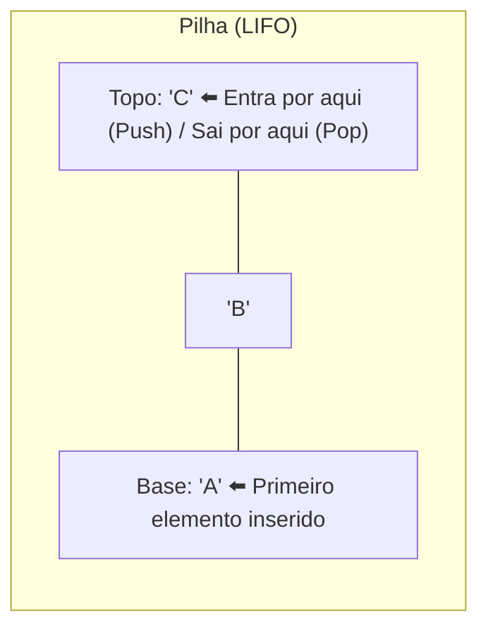
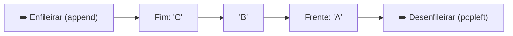

# 📦 Estruturas de Dados em Python: Pilhas e Filas

<p align="left">
  
  
  
  
</p>

Este repositório contém a implementação prática e documentação completa sobre **Pilhas (*Stacks*)** e **Filas (*Queues*)**, duas das estruturas de dados lineares mais fundamentais da Ciência da Computação.

---

## 📑 Sumário

- [1. Pilha (*Stack*) — LIFO](#1-pilha-stack--lifo)
  - [O Conceito LIFO](#o-conceito-lifo)
  - [Estrutura Visual da Pilha](#estrutura-visual-da-pilha)
  - [Implementação Prática (`pilha.py`)](#implementação-prática-pilhapy)
  - [Caso de Uso: Inversão de Texto](#caso-de-uso-inversão-de-texto)
- [2. Fila (*Queue*) — FIFO](#2-fila-queue--fifo)
  - [O Conceito FIFO](#o-conceito-fifo)
  - [Estrutura Visual da Fila](#estrutura-visual-da-fila)
  - [Performance: `collections.deque` vs `list`](#performance-collectionsdeque-vs-list)
  - [Implementação Prática (`fila.py`)](#implementação-prática-filapy)
- [3. Tabela Comparativa](#3-tabela-comparativa)
- [4. Como Executar os Códigos](#4-como-executar-os-códigos)

---

## 1. Pilha (*Stack*) — LIFO

### O Conceito LIFO
A **Pilha** opera sob a regra **LIFO** (*Last In, First Out* — *O último a entrar é o primeiro a sair*).

* **Exemplo do mundo real:** Uma pilha de pratos ou livros. O último colocado em cima é o primeiro que deve ser retirado.
* **Exemplos na computação:**
  * O recurso "Desfazer" (*Ctrl + Z*) em editores de texto;
  * O histórico de navegação ("Voltar" no navegador);
  * A *Call Stack* (pilha de chamadas de funções do interpretador Python).

### Estrutura Visual da Pilha



### Implementação Prática ([pilha.py](./pilha.py))

A classe `Pilha` encapsula os dados e expõe as operações clássicas:

```python
class Pilha:
    def __init__(self):
        self.itens = []

    def empilhar(self, item):
        """Adiciona um item ao topo da pilha (push)."""
        self.itens.append(item)

    def esta_vazia(self):
        """Verifica se a pilha não possui elementos."""
        return len(self.itens) == 0

    def tamanho(self):
        """Retorna o total de elementos na pilha."""
        return len(self.itens)

    def desempilhar(self):
        """Remove e retorna o item do topo (pop). Lança erro se vazia."""
        if self.esta_vazia():
            raise IndexError("Desempilhar de uma pilha vazia")
        return self.itens.pop()

    def topo(self):
        """Retorna o item no topo sem removê-lo (peek)."""
        if self.esta_vazia():
            raise IndexError("Topo de uma pilha vazia")
        return self.itens[-1]

    def esvaziar(self):
        """Esvazia a pilha."""
        self.itens = []

    def __str__(self):
        return f"Pilha({self.itens}) <- topo"
```

### Caso de Uso: Inversão de Texto

Como o último caractere empilhado é o primeiro a ser desempilhado, a pilha é a estrutura ideal para inversão de sequências:

```python
def inverter(texto):
    x = Pilha()
    for letra in texto:
        x.empilhar(letra)
    resultado = ""
    while not x.esta_vazia():
        resultado += x.desempilhar()
    return resultado

print(inverter("Thiago"))  # Saída: ogaihT
```

---

## 2. Fila (*Queue*) — FIFO

### O Conceito FIFO
A **Fila** opera sob a regra **FIFO** (*First In, First Out* — *O primeiro a entrar é o primeiro a sair*).

* **Exemplo do mundo real:** Fila de atendimento em um banco ou caixa de supermercado. Quem chega primeiro é atendido primeiro.
* **Exemplos na computação:**
  * Spool de impressão (fila de documentos para imprimir);
  * Filas de mensagens (RabbitMQ, Kafka, Celery);
  * Algoritmos de busca em largura (*Breadth-First Search* - BFS).

### Estrutura Visual da Fila



### Performance: `collections.deque` vs `list`

Em Python, **nunca** devemos usar listas normais (`list`) para implementar filas em sistemas reais:
* Com `list.pop(0)`: complexidade de tempo **$O(n)$**, pois desloca todos os outros elementos na memória.
* Com `collections.deque`: lista duplamente encadeada em C, onde `popleft()` é executado em **$O(1)$** (tempo constante).

| Operação | `list` nativa | `collections.deque` | Vantagem do `deque` |
| :--- | :---: | :---: | :--- |
| **Inserção no final (`append`)** | $O(1)$ amortizado | $O(1)$ | Ambos rápidos |
| **Remoção no início (`popleft`)** | **$O(n)$** (Lento) | **$O(1)$** (Instantâneo) | **Muito superior em filas** |

### Implementação Prática ([fila.py](./fila.py))

```python
from collections import deque

class Fila:
    def __init__(self):
        self._itens = deque()

    def enfileirar(self, item):
        """Adiciona um item ao final da fila."""
        self._itens.append(item)

    def esta_vazia(self):
        """Informa se a fila está vazia."""
        return len(self._itens) == 0

    def tamanho(self):
        """Retorna o número de elementos na fila."""
        return len(self._itens)

    def desenfileirar(self):
        """Remove e retorna o item do início da fila."""
        if self.esta_vazia():
            raise IndexError("Não é possível desenfileirar, a fila está vazia")
        return self._itens.popleft()

    def frente(self):
        """Consulta o primeiro elemento da fila sem remover."""
        if self.esta_vazia():
            raise IndexError("A fila está vazia")
        return self._itens[0]

    def esvaziar(self):
        """Limpa toda a fila."""
        self._itens.clear()

    def __str__(self):
        return f"Frente -> {list(self._itens)} <- Fim"
```

---

## 3. Tabela Comparativa

| Propriedade | Pilha (*Stack*) | Fila (*Queue*) |
| :--- | :--- | :--- |
| **Regra de Ordem** | **LIFO** (*Last In, First Out*) | **FIFO** (*First In, First Out*) |
| **Onde insere?** | No Topo (`empilhar` / `append`) | No Fim (`enfileirar` / `append`) |
| **Onde remove?** | No Topo (`desempilhar` / `pop`) | Na Frente (`desenfileirar` / `popleft`) |
| **Inspeção / Consulta** | `topo()` (ou *peek*) | `frente()` (ou *front*) |
| **Complexidade Inserção** | $O(1)$ | $O(1)$ (com `deque`) |
| **Complexidade Remoção** | $O(1)$ | $O(1)$ (com `deque`) |
| **Analogia Diária** | Pratos empilhados | Fila de lotérica |

---

## 4. Como Executar os Códigos

Clone o repositório ou navegue até a pasta:

```bash
# Executar a Pilha
python pilha.py

# Executar a Fila
python fila.py
```

---

<p align="center">
  Feito com 💻 e ☕ para fins educacionais.
</p>
